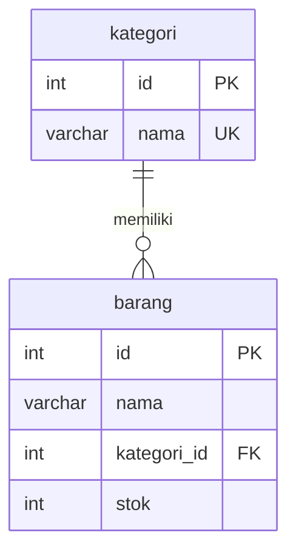

# React + Vite

This template provides a minimal setup to get React working in Vite with HMR and some ESLint rules.

## Menjalankan aplikasi (frontend + backend + database)

Aplikasi ini memakai **MySQL dari Laragon** dan **REST API Express** di folder `server/`.

**Prasyarat:** Node.js 20+ dan Laragon dengan MySQL aktif di port `3306`.

```bash
# 1. Pastikan MySQL Laragon berjalan (tombol Start di Laragon)

# 2. Install dependency backend
npm --prefix server install

# 3. Buat konfigurasi lokal (default sudah cocok untuk Laragon: root tanpa password)
copy server\.env.example server\.env

# 4. Isi data awal (anggota, kategori, barang) — aman dijalankan berulang
npm run seed

# 5. Jalankan API di terminal pertama (http://localhost:3000)
npm run server

# 6. Jalankan frontend di terminal kedua
npm run dev
```

Buka `http://localhost:5173`. Data tersimpan di database `pelatihan_bnsp`:
tabel `members` (anggota tim), serta `kategori` dan `barang` (relasi satu kategori ke banyak barang).

**Endpoint API:**

| Method | Path | Keterangan |
| --- | --- | --- |
| GET | `/api/members` | Daftar anggota |
| POST | `/api/members` | Tambah anggota (status Online, rating 0, avatar & id dari server) |
| PUT | `/api/members/:id` | Ubah anggota (body boleh sebagian: data form, status, atau rating) |
| DELETE | `/api/members/:id` | Hapus anggota |
| GET | `/api/kategori` | Daftar kategori (untuk dropdown form barang) |
| GET | `/api/barang` | Daftar barang + nama kategori (query JOIN) |
| GET | `/api/barang/:id` | Detail satu barang |
| POST | `/api/barang` | Tambah barang (nama wajib, stok bilangan bulat ≥ 0, kategori harus ada) |
| PUT/PATCH | `/api/barang/:id` | Ubah barang (body boleh sebagian) |
| DELETE | `/api/barang/:id` | Hapus barang |

**Test frontend:** `npm run test` (validasi form barang + mapper berita).
**Test backend:** `npm run test:server` (memakai database terpisah `pelatihan_bnsp_test`).

**Fitur UI Barang (Bagian 3–4):** tab **📦 Data Barang** berisi form tambah/edit
(nama, kategori, stok), tabel daftar barang, state loading/error/kosong,
dialog konfirmasi hapus, dan notifikasi sukses/gagal.

**Praktik SQL (Bagian 1):** buka `server/sql/praktik.sql`. Isinya contoh `SELECT`, `WHERE`,
`ORDER BY`, `UPDATE`, `DELETE`, `JOIN`, serta uji foreign key dan check constraint.
Contoh yang mengubah data dibungkus `START TRANSACTION` … `ROLLBACK` supaya data asli aman.

**ERD singkat:**



Saat development, frontend memanggil `/api` dan Vite mem-proxy ke `localhost:3000` (lihat `vite.config.js`).
Backend juga memasang middleware CORS untuk frontend di origin berbeda. Daftar origin diatur lewat
`CORS_ORIGIN` di `server/.env` (default: `http://localhost:5173,http://127.0.0.1:5173`).

## Template notes

Currently, two official plugins are available:

- [@vitejs/plugin-react](https://github.com/vitejs/vite-plugin-react/blob/main/packages/plugin-react) uses [Oxc](https://oxc.rs)
- [@vitejs/plugin-react-swc](https://github.com/vitejs/vite-plugin-react/blob/main/packages/plugin-react-swc) uses [SWC](https://swc.rs/)

## React Compiler

The React Compiler is not enabled on this template because of its impact on dev & build performances. To add it, see [this documentation](https://react.dev/learn/react-compiler/installation).

## Expanding the ESLint configuration

If you are developing a production application, we recommend using TypeScript with type-aware lint rules enabled. Check out the [TS template](https://github.com/vitejs/vite/tree/main/packages/create-vite/template-react-ts) for information on how to integrate TypeScript and [`typescript-eslint`](https://typescript-eslint.io) in your project.
